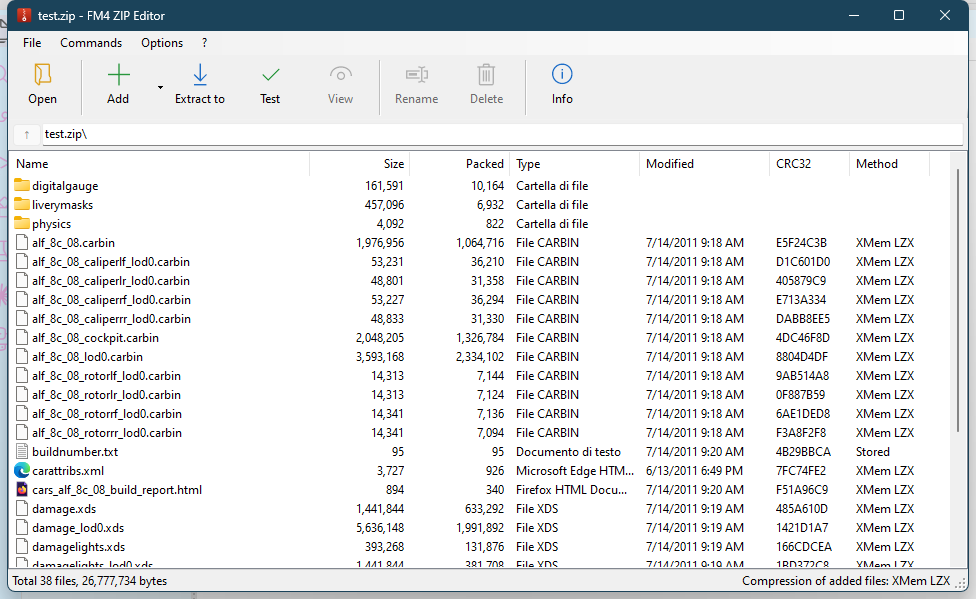

# FM4 ZIP Editor

A small WinRAR-style editor for the `.zip` archives of **Forza Motorsport 4** (cars, UI, livery, audio...).

These archives are normal ZIP files, but almost every entry is compressed with **method 21 (Xbox 360 XMem LZX)**, which regular tools (WinRAR, 7-Zip, Explorer) cannot read or write. This tool can.



## Features

- Open / create `.zip` archives, browse folders, sortable columns (size, packed size, type, date, CRC32, method)
- **Add** files or whole folders (button, menu, or drag & drop onto the window)
- **Extract** the selection or the whole archive; drag files out of the window to Explorer
- **Test** archive integrity (CRC32 check of every file)
- **Rename** and **Delete** files and folders
- **View**: double-click opens the file with its associated program; if you edit and save it, the editor offers to update the archive
- Choose the compression used for added files: XMem LZX (default, what the game uses), Deflate, or stored
- Every change rewrites the archive atomically (temp file + replace), like WinRAR. **Work on a copy of your archives.**

## Download / build

Requirements: Windows 10/11 (the .NET Framework 4.x that ships with Windows is enough, no SDK needed).

```powershell
# put xcompress32.dll next to build.ps1 first (see below), then:
powershell -ExecutionPolicy Bypass -File build.ps1
```

This produces `FM4ZipEditor.exe`, a single self-contained x86 executable with `xcompress32.dll` embedded.
Use `build.ps1 -NoEmbed` to build without embedding it; the exe will then look for `xcompress32.dll` in its own folder.

### About `xcompress32.dll`

XMem LZX is implemented by Microsoft's `xcompress32.dll` (Xbox 360 SDK / XDK). It is **not included in this repository** because it is not ours to redistribute: copy it from your own Forza modding tools or Xbox 360 SDK installation. It must be the 32-bit version, which is why the app is built as x86.

## Format notes

Things that are easy to get wrong when rewriting these archives (all handled here):

- Entries use method `21` (XMem LZX); the uncompressed size from the ZIP header is required to decompress.
- Every central-directory entry carries an extra field `0x1123` (4 bytes) holding the **absolute offset of the entry's data**. It must be recomputed whenever an archive is rewritten.
- Local headers have no extra field and no data descriptors; names use `/` separators.
- Rewriting an untouched archive produces a **byte-identical** file (used as a self-test).

## Tests

`SelfTest.cs` checks the engine against a real archive: CRC of every entry, byte-identical rewrite, XMem round trip, add / rename / unicode names / empty files.

```powershell
$csc = "$env:WINDIR\Microsoft.NET\Framework\v4.0.30319\csc.exe"
& $csc /nologo /platform:x86 /out:selftest.exe ForZip.cs SelfTest.cs
.\selftest.exe "C:\path\to\some_car.zip" "C:\path\to\empty_work_dir"
```

## Disclaimer

Unofficial fan tool, not affiliated with Microsoft, Turn 10 Studios or Playground Games. No game files are included. Use it only on your own copies of the game data.

## License

[MIT](LICENSE) for the code in this repository. `xcompress32.dll` is Microsoft's and is not covered by it.
